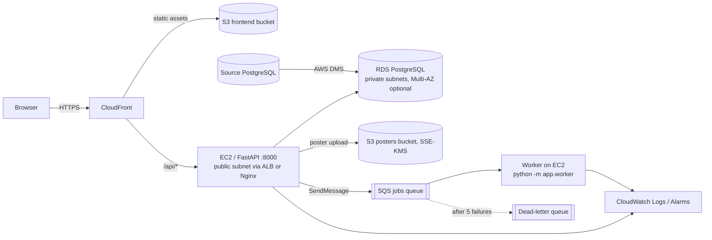

# AWS architecture and the eight course modules

> **Honest status:** nothing in this repository has been deployed to AWS and no AWS migration has been run.
> The app runs fully locally. The S3 and SQS adapters (`backend/app/aws.py`) are real boto3 code but were **not
> exercised against a live account**. `infra/aws-resources.yaml` and the CLI steps below are provided as
> starting points; review and validate them (`aws cloudformation validate-template`) before use.

## Module → service mapping

| # | Module | What is used | Where in repo |
|---|--------|--------------|---------------|
| 1 | Cloud Foundations & IAM | EC2 instance role with least-privilege policy; no long-lived keys in `.env` | `infra/iam-policies.json`, `infra/aws-resources.yaml` |
| 2 | Compute & Storage | EC2 runs FastAPI (+ worker); S3 stores posters (`STORAGE_BACKEND=s3`) and the built frontend | `backend/app/aws.py` |
| 3 | Networking & Content Delivery | VPC, 2 public + 2 private subnets, route tables, security groups, CloudFront in front of S3 + API | steps below |
| 4 | Database Services | RDS PostgreSQL in private subnets, automated backups, optional Multi-AZ / read replica | steps below |
| 5 | Management & Cost | CloudWatch log group, alarms, AWS Budgets | steps below |
| 6 | Security & Compliance | KMS key for S3/SQS/RDS, TLS at CloudFront/ALB, Secrets Manager for `JWT_SECRET`/DB password | `infra/aws-resources.yaml` |
| 7 | Application Integration | SQS queue + DLQ, producer in API (`QUEUE_BACKEND=sqs`), consumer `app/worker.py` | `backend/app/aws.py`, `backend/app/worker.py` |
| 8 | Migration & Hybrid | DMS full-load from a local/source PostgreSQL into RDS, with validation | steps below |

## Deployment steps (CLI sketch - set `REGION`, `ACCOUNT_ID`; adjust names)

**1-2, 6-7: IAM, KMS, S3, SQS** - `aws cloudformation deploy --template-file infra/aws-resources.yaml --stack-name campusconnect --capabilities CAPABILITY_IAM`. Create a second S3 bucket for the frontend (block public access; serve through CloudFront with Origin Access Control).

**3: Networking** - create a VPC (`10.0.0.0/16`), two public subnets (EC2/ALB) and two private subnets (RDS) in different AZs, an internet gateway with a public route table (`0.0.0.0/0 → igw`), and a private route table with no internet route. Security groups: `app-sg` allows 443/80 from the internet (or only from CloudFront's managed prefix list) and SSH only from your IP; `db-sg` allows TCP 5432 **only from `app-sg`**. CloudFront: origin 1 = frontend bucket (default behaviour), origin 2 = API (`/api/*` and `/uploads/*`, caching disabled, forward `Authorization` header). Add an SPA fallback: custom error response 403/404 → `/index.html`.

**4: RDS** - `aws rds create-db-subnet-group` (private subnets), then `aws rds create-db-instance --engine postgres --db-instance-class db.t4g.micro --allocated-storage 20 --storage-encrypted --kms-key-id <key> --backup-retention-period 7 --no-publicly-accessible --vpc-security-group-ids <db-sg> --master-user-password <from Secrets Manager>`. For HA add `--multi-az` (roughly doubles instance cost); for read scaling use `aws rds create-db-instance-read-replica`. Then on EC2: set `DATABASE_URL`, run `alembic upgrade head` and `python -m app.seed` (demo data only).

**EC2 app host** - Amazon Linux 2023, attach the instance profile, install Python 3.12, `pip install -r requirements.txt`, run `uvicorn app.main:app --host 127.0.0.1 --port 8000` as a systemd service behind Nginx or an ALB with an ACM certificate. Run `python -m app.worker` as a second service. Env: `STORAGE_BACKEND=s3`, `S3_BUCKET`, `S3_PUBLIC_BASE_URL=https://<cloudfront-domain>` (add a `/posters/*` behaviour to the posters bucket origin), `QUEUE_BACKEND=sqs`, `SQS_QUEUE_URL`.

**5: Management & Cost** - install the CloudWatch agent to ship `/var/log/campusconnect/*.log` to `/campusconnect/app`; alarms: EC2 `StatusCheckFailed`, RDS `CPUUtilization > 80%` and `FreeStorageSpace`, SQS DLQ `ApproximateNumberOfMessagesVisible > 0`, ALB/API 5xx. `aws budgets create-budget` with a monthly cost limit and an 80% email alert.

**8: DMS migration** - (a) stand up a *source* PostgreSQL with the sample data (e.g. local Docker with `python -m app.seed`, reachable from AWS via VPN/public IP restricted to the replication instance; set `wal_level=logical` if you want CDC). (b) Run `alembic upgrade head` on RDS first so the schema exists. (c) Create a DMS replication subnet group + replication instance in the VPC, source and target endpoints, and a task (`full-load`, table mapping `public.%`, target table prep mode `TRUNCATE_BEFORE_LOAD`/`DO_NOTHING`). (d) Validate: enable DMS data validation on the task and compare `SELECT count(*)` for `users, events, registrations` on both sides; spot-check a few rows. (e) Cleanup: stop and delete the task, endpoints and replication instance (the instance bills hourly).

## Cost / resource cleanup
Delete in reverse order: DMS task/endpoints/instance → CloudFront distribution (disable first, wait) → EC2 and Elastic IPs/ALB → RDS (take or skip final snapshot deliberately; delete read replicas first) → NAT gateways if you added any → empty and delete S3 buckets → `aws cloudformation delete-stack --stack-name campusconnect` (KMS keys are scheduled for deletion after 7-30 days) → CloudWatch log groups → budgets. Check Cost Explorer a day later.
